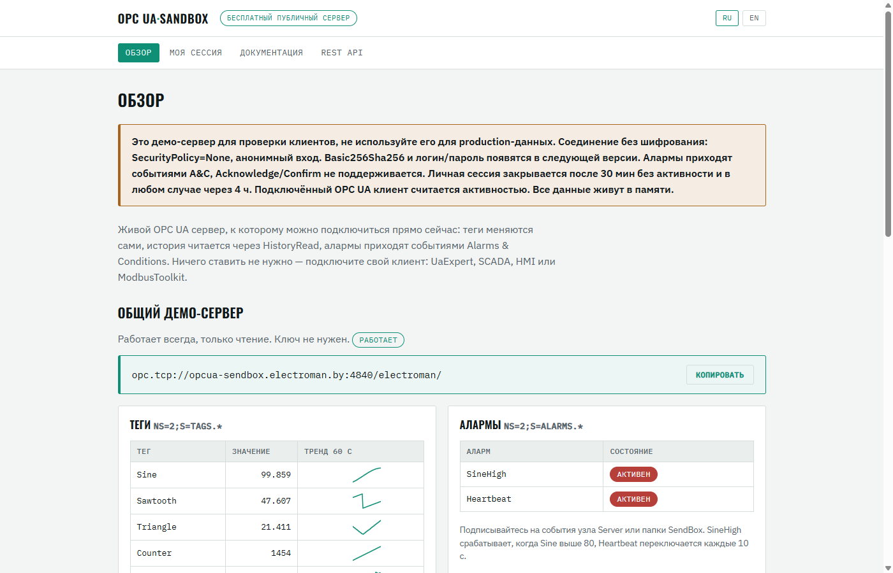
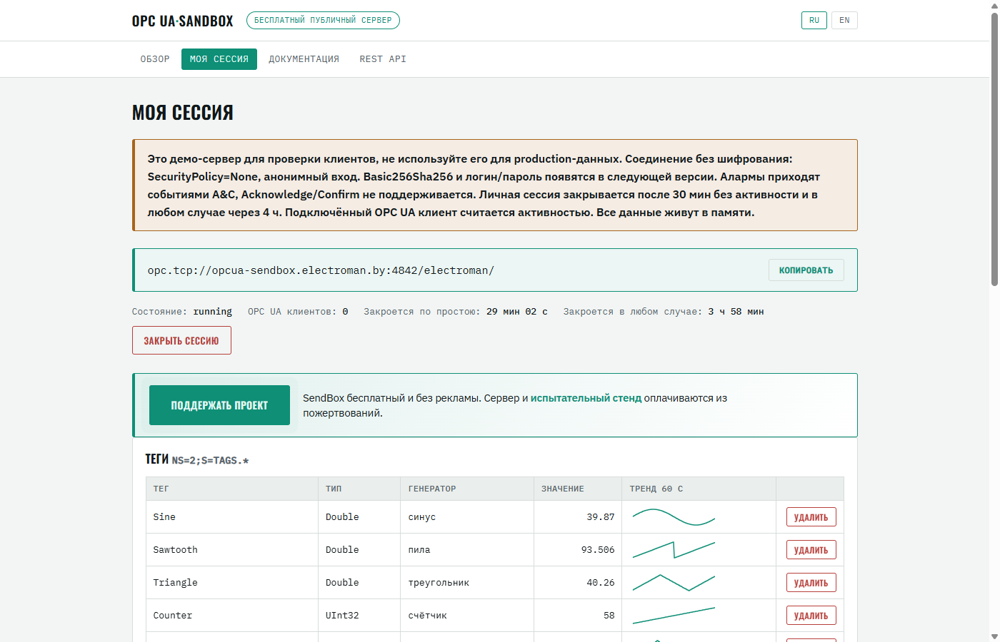
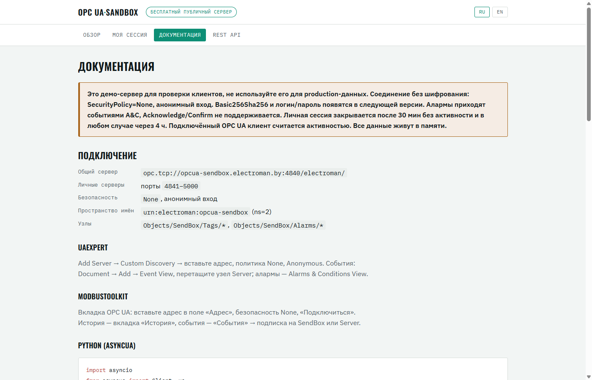
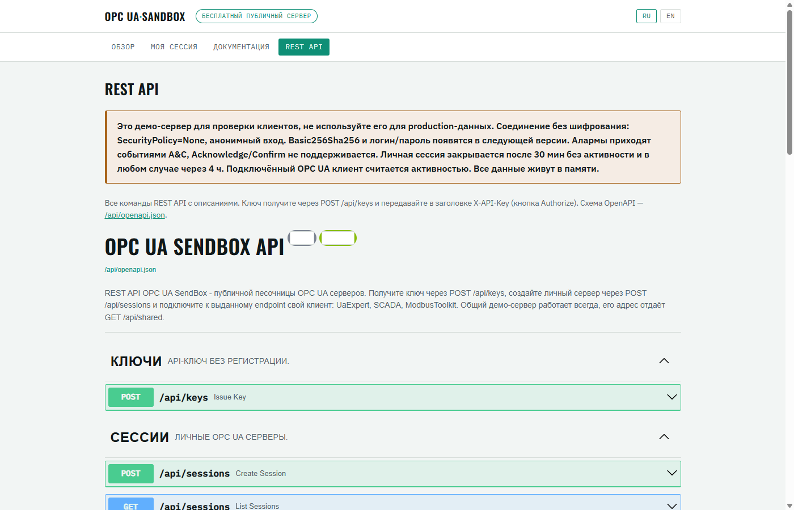

<p align="center">
  <a href="https://github.com/StarLeG/opcua-sendbox/actions/workflows/ci.yml"></a>
  
  
  
  <a href="https://opcua-sendbox.electroman.by"></a>
</p>

<h1 align="center">OPC UA SendBox</h1>

<p align="center">
  <b>Живой OPC UA сервер, к которому можно подключиться прямо сейчас.</b><br>
  Теги меняются сами, история читается через HistoryRead, алармы приходят событиями
  Alarms &amp; Conditions. Ничего ставить не нужно.
</p>

Песочница для проверки OPC UA клиентов: SCADA, HMI, UaExpert, своего кода,
[ModbusToolkit](https://modbustoolkit.electroman.by). Есть общий демо-сервер, который
работает всегда, и личные серверы: свой порт, свои теги и алармы, запись из клиента.

## Подключиться за минуту

| Параметр | Значение |
|---|---|
| Общий сервер | `opc.tcp://opcua-sendbox.electroman.by:4840/electroman/` |
| Безопасность | `None`, анонимный вход |
| Пространство имён | `urn:electroman:opcua-sendbox` (ns=2) |
| Узлы | `Objects/SendBox/Tags/*`, `Objects/SendBox/Alarms/*` |
| Web UI | [opcua-sendbox.electroman.by](https://opcua-sendbox.electroman.by) |

Проверка из Python:

```python
import asyncio
from asyncua import Client

async def main():
    async with Client("opc.tcp://opcua-sendbox.electroman.by:4840/electroman/") as client:
        print("Sine =", await client.get_node("ns=2;s=Tags.Sine").read_value())

asyncio.run(main())
```

Как подключиться из UaExpert и ModbusToolkit, написано в разделе «Документация» на сайте.

## Что умеет

- **Теги всех ходовых типов.** Double, Float, Int16/32, UInt16/32, Boolean. Значения
  считают генераторы: синус, пила, треугольник, меандр, счётчик, шум, блуждание,
  ступеньки, ШИМ и ещё несколько. Генераторы общие с
  [Modbus SendBox](https://modbus-sendbox.electroman.by).
- **История.** HistoryRead Raw возвращает последние значения каждого тега, в том
  числе записанные клиентом без SourceTimestamp: так пишет, например, UaExpert.
- **Алармы.** ExclusiveLimitAlarmType по порогу тега с гистерезисом, периодические и
  ручные AlarmConditionType. Поля условия (ConditionId, Retain, ActiveState) заполнены,
  ConditionRefresh работает, события приходят и на узел Server, и на папку SendBox.
- **Личные серверы.** Отдельный процесс и порт на каждую сессию, так что сбой одного
  пользователя не задевает других. Теги и алармы добавляются из UI или через REST,
  writable-константы принимают запись из клиента.
- **Web UI на русском и английском.** Живые значения с мини-графиками, формы тегов и
  алармов, кнопки «Активировать» и «Сбросить», журнал записей и событий.
- **REST API и метрики.** Swagger на `/api/docs`, Prometheus на `/metrics`, healthcheck
  на `/healthz`.

## Как это выглядит

<table>
  <tr>
    <td width="50%"></td>
    <td width="50%"></td>
  </tr>
  <tr>
    <td align="center"><sub>Обзор: общий демо-сервер, теги и алармы</sub></td>
    <td align="center"><sub>Личный сервер: endpoint, теги и генераторы</sub></td>
  </tr>
  <tr>
    <td width="50%"></td>
    <td width="50%"></td>
  </tr>
  <tr>
    <td align="center"><sub>Документация: подключение из UaExpert и ModbusToolkit</sub></td>
    <td align="center"><sub>REST API в оформлении сайта</sub></td>
  </tr>
</table>

## Личный сервер через API

```bash
KEY=$(curl -s -X POST https://opcua-sendbox.electroman.by/api/keys | jq -r .key)
curl -s -X POST -H "X-API-Key: $KEY" https://opcua-sendbox.electroman.by/api/sessions
# → {"endpoint_url": "opc.tcp://opcua-sendbox.electroman.by:4841/electroman/", ...}
```

Ключ выдаётся без регистрации. Сессия сразу содержит демо-набор тегов и два аларма.
Свои теги и алармы можно передать в теле запроса или добавить позже:
`POST /api/sessions/{id}/tags`, `POST /api/sessions/{id}/alarms`,
`POST /api/sessions/{id}/alarms/{name}/trigger`.

Контракт версионирован: канонические пути `/api/v1/...`, неверсионированные
`/api/...` работают как совместимый алиас. Версия сервиса, поддерживаемые
возможности и лимиты — в `GET /api/capabilities` (ADR-003).

## Ограничения

- Соединение без шифрования (`SecurityPolicy=None`), вход анонимный. Basic256Sha256 и
  логин/пароль появятся в следующей версии.
- Acknowledge и Confirm не поддерживаются: аларм сразу считается квитированным.
  `LimitState` в событии нет, потому что state machine `ExclusiveLimitAlarmType` в
  asyncua не реализована (ADR-002).
- Личная сессия закрывается после 30 минут без активности и в любом случае через
  4 часа. Подключённый OPC UA клиент считается активностью.
- Лимиты: 2 сессии на ключ, 4 на IP, 50 всего; 100 тегов и 20 алармов на сессию.
- Всё живёт в памяти: перезапуск сервиса закрывает сессии.

## Свой сервер

Локально:

```bash
git clone https://github.com/StarLeG/opcua-sendbox.git
cd opcua-sendbox
uv sync
uv run python -m app
```

Web UI откроется на http://127.0.0.1:8766, общий OPC UA сервер слушает порт 4840. Если
4840 занят (на Windows его часто держит OPC Foundation LDS), запустите с
`OPCUA_SHARED_PORT=4850 OPCUA_PUBLIC_HOST=localhost`.

В Docker:

```bash
docker compose up -d --build
```

Для своей инсталляции задайте `OPCUA_PUBLIC_HOST`: этот адрес сервер объявляет
клиентам в endpoint. Все переменные перечислены в [.env.example](.env.example), варианты
с nginx, systemd и host-сетью, мониторинг и чек-лист приёмки описаны в
[docs/DEPLOY.md](docs/DEPLOY.md).

## Стек

Python 3.11 и новее, [asyncua](https://github.com/FreeOpcUa/opcua-asyncio) 2.x,
FastAPI и uvicorn. Каждый OPC UA сервер работает в своём процессе (`multiprocessing`,
spawn) и общается с web-процессом через очереди (ADR-001).

## Разработка

```bash
uv run pytest                    # unit и интеграционные тесты с настоящими серверами
uv run pytest tests/unit         # только быстрые
uv run ruff check .
uv run mypy app tests
```

CI гоняет то же самое на Python 3.11 и 3.14. Карта задач лежит в [ISSUES.md](ISSUES.md),
архитектурные решения в [docs/adr/](docs/adr/).

## Другие продукты

| Проект | Что это |
|---|---|
| [ModbusToolkit](https://modbustoolkit.electroman.by) | Бесплатный сниффер, сканер и эмулятор Modbus RTU/TCP для Windows и Linux, с клиентом OPC UA |
| [Modbus SendBox](https://modbus-sendbox.electroman.by) | Публичный тестовый Modbus TCP сервер: 10 слейвов, генераторы значений, инъекции ошибок |

## Поддержать проект

SendBox бесплатный и без рекламы. Сервер и испытательный стенд оплачиваются из
пожертвований. Если песочница сэкономила вам вечер у стенда,
[поддержите разработку](https://modbustoolkit.electroman.by/support.html).

## Об авторе

Олег Старинский: инженер-наладчик автоматики, пишу инструменты, которыми пользуюсь сам
на объектах. C++/Qt, Python, STM32.
[GitHub](https://github.com/StarLeG) · [electroman.by](https://electroman.by) ·
[Telegram](https://t.me/modbustoolkit)
